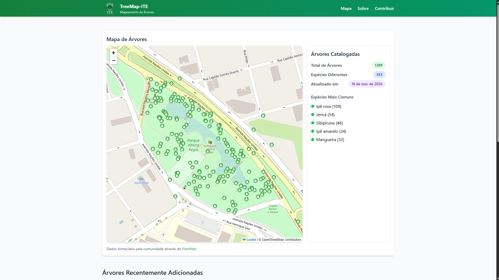

<div align="center">

# 🌳 TreeMap-ITE
### Interactive tree observation and environmental mapping

**An educational, collaborative web project connecting geographic visualization and environmental data.**

[**🌐 Live website**](https://treemap.savi.tec.br/) · [**👤 Leonardo Ribeiro**](https://github.com/leoribeirodev)

</div>

---

## About the project

TreeMap-ITE helps visualize tree observations associated with educational and community activities in the Bauru region of São Paulo, Brazil. The web interface integrates interactive maps, species information, observation cards, and environmental-measurement processing.

> **Public source snapshot:** This repository contains selected frontend/source components for portfolio and educational review. It is **not** the complete production system or a fully functional standalone deployment. The protected PHP API, administrative interface, gallery service configuration, email service configuration, scientific data redistribution, and event photos are intentionally excluded.

## Features visible in the source

- Interactive maps built with **Leaflet** and OpenStreetMap tiles
- Geographic markers, observation details, and recent-observation cards
- Desktop/mobile statistics and responsive UI
- Support for observation measurements, including `C=...;A=...` and an older slash-separated format
- Integration layer for retrieving and normalizing externally sourced observation data
- Environmental calculation routines that require separate scientific reference data
- Public information pages explaining the project and how to contribute
- Frontend escaping of observation text and HTTP(S)-only validation for external image URLs in this curated snapshot

## Screenshots

### Interactive Map & Environmental Overview

Explore geolocated tree observations through an
interactive map featuring catalog statistics,
species information, and environmental data.



*Map data © [OpenStreetMap contributors](https://www.openstreetmap.org/copyright). Observations are provided through Pl@ntNet.*

## Tech stack

`HTML5` · `CSS3` · `JavaScript` · `Tailwind CSS` · `Leaflet` · `Font Awesome` · `JSON` · `REST-style API integration`

**Backend in production:** protected PHP service (not included here).  
**Scientific reference:** a separate wood-density dataset is used by the live application (not distributed in this snapshot).

## Structure

```text
.
├── index.html                 # Main map and UI
├── sobre.html                 # About page (gallery integration removed)
├── contribuir.html            # Contribution guide (email form disabled)
├── api.js                     # Frontend observation fetching and rendering
├── dados-ambientais.js       # Species/environmental reference logic
├── calculos-ambientais.js    # Environmental calculation routines
├── style.css
├── assets/img/                # Minimal site branding assets
└── docs/                      # Architecture and disclosure notes
```

## Running the public snapshot locally

1. Download or clone the repository.
2. From the project directory, start a static HTTP server:

   ```bash
   python -m http.server 8000
   ```

3. Open `http://localhost:8000`.

The static layout and base map can be previewed, but **observation data will not load** because the frontend references a protected endpoint at `/api/api.php`, whose implementation is intentionally absent. The project gallery and email submission are also disabled in this snapshot. Environmental calculations that require the excluded dataset will be unavailable. For the full working experience, visit the [official TreeMap website](https://treemap.savi.tec.br/).

## Source disclosure and security

- This curated snapshot adds output encoding for externally sourced observation text and validates image URL schemes; these hardening changes are **not** claimed to be deployed on the live site.

- No authentication, administrative interface, server credentials or private PHP implementation are distributed here.
- Frontend JavaScript is not a secure location for secrets. Never add private API keys, tokens or credentials to this repository.
- This repository was assembled as a **separate, curated source snapshot**; it is not a copy of the production Git history.
- The TreeMap logo and favicon are included with project authorization for portfolio presentation.
- A public source snapshot should not be used as a replacement for a security review of the live service.

## Credits and contributions

TreeMap-ITE is a collaborative educational project associated with **Instituição Toledo de Ensino (ITE)**. Its development combines project coordination, tree-observation work, and software engineering.

- **Leonardo Ribeiro — Lead Developer and Code Maintainer:** responsible for most of the application's implementation and its ongoing code maintenance.
- **Prof. Rodrigo Guarnetti — Project Coordinator:** project guidance and oversight.
- **Bruno Savi — Project Coordinator:** coordination and planning.
- **Tree observation contributors:** Ana Clara Piva, Ricardo Henrique, Murilo Cardoso, Maria Julia Melo, and Julio Cesar Bosco.

The project is collaborative in its planning and field observations, while Leonardo is responsible for the application's main software implementation. This repository is a curated portfolio snapshot, **not** the entire production system.

See [Contributions and Project Credits](docs/CONTRIBUTIONS.md) for the detailed breakdown of responsibilities.


## Licensing

**No open-source license is granted by this snapshot.** Source visibility does not automatically authorize reuse or redistribution. A license may be added after confirming the project owner's requirements and rights for the included materials.
