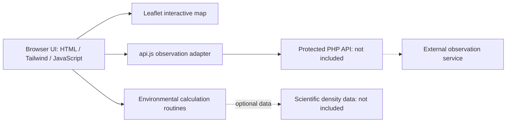

# Architectural overview (public-source description)

This diagram describes relationships visible in the source snapshot; it is **not** a complete production infrastructure diagram.

## Data flow

1. The frontend displays the geographic areas and establishes Leaflet map controls.
2. The observation adapter requests project-specific data from a protected PHP endpoint (not part of this repository).
3. Results are normalized, deduplicated and displayed as markers, cards and statistics.
4. Environmental calculations may reference scientific density data that is omitted until redistribution rights are confirmed.

## Components intentionally not distributed

- PHP service implementation and service credentials
- Administrative interface and any authentication/session logic
- EmailJS service identifiers and message-submission integration
- Google Apps Script gallery endpoint and event photographs
- Original scientific wood-density JSON dataset

The `contribuir.html` form is **demonstration-only** here: it cannot send emails. The gallery is replaced with a link to the official live website. In a local preview, observations require a separately configured backend, which is not supplied.

## Frontend security note

The published snapshot contains targeted defensive changes to `api.js`: external observation text is HTML-escaped before being interpolated into template strings; statistics are inserted via `textContent`; and image URLs are restricted to HTTP(S) protocols. This is a source review measure, **not** a comprehensive security audit. These changes were made in the public copy only and do not imply a production deployment.
